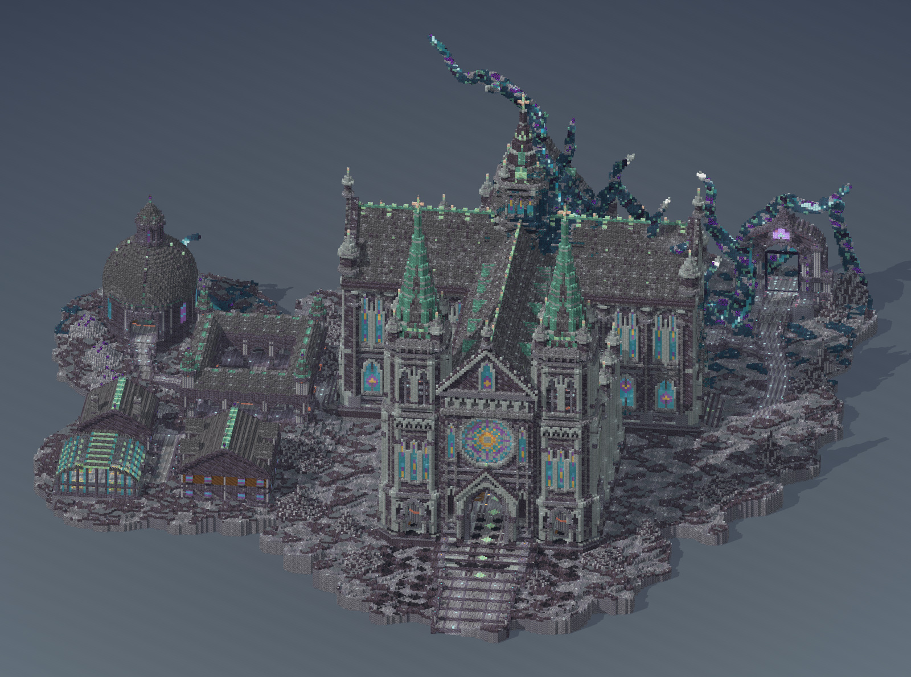
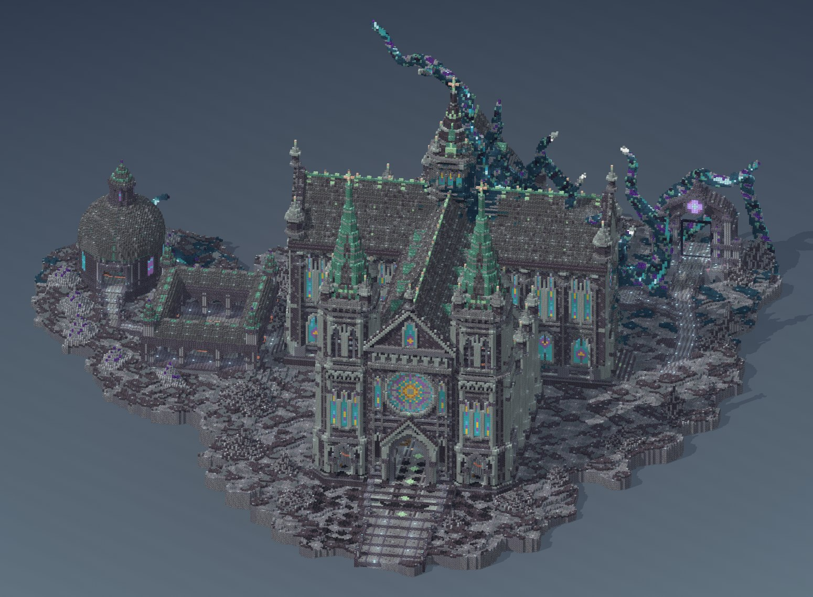

# Собор Лунных Шпилей

## Аббатство Лунных Шпилей — Печать глубин

[Скачать `.litematic`](moonspire-cathedral-catacombs.litematic) · [Общий вид](moonspire-cathedral-catacombs-preview.jpg) · [Восточный очаг](moonspire-cathedral-catacombs-sculk.jpg) · [Восточный мост](moonspire-cathedral-catacombs-crossing.jpg) · [Жилой двор](moonspire-cathedral-catacombs-yard.jpg) · [Неф](moonspire-cathedral-catacombs-nave.jpg) · [Галерея имён](moonspire-cathedral-catacombs-gallery.jpg) · [Семь колоколов](moonspire-cathedral-catacombs-bells.jpg) · [Корень под печатью](moonspire-cathedral-catacombs-heart.jpg) · [План катакомб](moonspire-cathedral-catacombs-map.png)


Обновлённая отдельная версия для **Minecraft Java 26.3 / Litematica**. Сохранились Лунный трон, жилой двор, часовня, башни с органной галереей и незажжённая рама портала **13 × 18**. У боковых входов, старого спуска в крипту и органного мостика переделаны перепады: ориентированные ступени и площадки связывают уровни без уступов в целый блок на основных маршрутах. Опасные края хора и восточного моста прикрыты ограждениями, а ответвление на смотровую площадку осталось открытым.

### Заражение и кладка

- **Само заражение — настоящий ванильный скалк.** Корни, наросты и ядро сложены из `minecraft:sculk`. Скалковые жилы закреплены на камне по краям очага, а на отростках стоят сенсоры и крикуны. Цветной бетон, искажённые наросты и светящиеся вставки больше не изображают скалк. Заражение выделяется силуэтом и фактурой рядом с кладкой; витражи и светильники остались деталями архитектуры.
- **Снаружи:** у порталов собора добавлены профили на разной глубине и резные опоры; на контрфорсах — глухие ниши между выступающими пилястрами. Восточный очаг выходит из старого разлома на кровлю и шпиль.
- **Внутри:** в нефе добавлены выступающие обрамления арок и консоли под капителями; в катакомбах — ступенчатые рёбра сводов, ниши над гробницами и резное обрамление печати. За стеклом виден корень с сенсором и крикуном. Основные проходы остаются свободны.

Ступени и плиты работают не только на подъёмах: из них собраны карнизы, кровля навеса, скосы опор и крышки гробниц. У входа — каменная мостовая с низкими перилами; восточный мост и смотровая площадка ограждены соединёнными стенками, с открытым проходом на развилке. У дома стоит дровяной навес со скамьёй и оградой из тёмного дуба. Пятнистый грунт заменён крупными пластами камня, ряды скамей нефа разделены поперечными проходами, а у гробниц различаются кладка, сколы и следы ремонта.

### Как ходить

- **Через собор:** из нефа к западной лестнице у хора, затем из старой крипты на запад по табличкам. Нижняя лестница приводит к мозаичному компасу **Распутья ключей**.
- **Через жилой двор:** от северной арки клуатра иди к дому; на медной дорожке справа от главного прохода — отдельный арочный вход в катакомбы. Это второй выход из подземного кольца, не тупик.
- **Под землёй:** к северу — **Галерея имён** и ответвление в **Лунный архив**, к востоку — скалковый корень за стеклом, на юге — **костница Семи Колоколов**. Зал с разломом можно обойти с обеих сторон. Медные метки ведут к лестницам; таблички подписывают развилки. В архиве есть небольшая отсылка к Древнему городу. Если вставляешь через Litematica и хочешь сохранить содержимое её сундука, не включай игнорирование содержимого контейнеров.

### Свет и спавн

Белые световые вставки убраны с большей части мостовой, а видимые фонари оставлены у входов и ориентиров. Тени заполнены ванильным невидимым блоком `minecraft:light`; специальный мод на блоки не нужен. Его надо перенести при вставке: одна голограмма не освещает мир. Для ручного строительства невидимый свет доступен в творческом режиме или через команды с правами; в выживании без прав его придётся заменить обычными источниками света и перепроверить тёмные места.

В схеме нет катализаторов, а у крикунов стоит `can_summon=false`: Хранителя они не призывают. В модели **уровень блочного света на потенциальных местах обычного наземного спавна — не ниже 4 без учёта неба**: проверены в том числе крыши, карнизы, двор, мост, жилые помещения и подземелье. На низких поверхностях катакомб и крипты есть нижние плиты, стекло или ковры: защита там не зависит только от света, который не останавливает подземных слизней.

Схема не управляет спавном во всём мире. Она не блокирует мобов, пришедших снаружи, и не исключает особые механики (например, фантомов или мобов от активированного портала). Не ставь постройку в болоте. Если нужно отключить **естественный спавн во всём мире**, проверь в копии мира `/gamerule minecraft:spawn_mobs false` с правами оператора; для отключения только естественного спавна монстров — `/gamerule minecraft:spawn_monsters false`. Это настройки мира, не часть файла, и они не удаляют уже существующих мобов.

**341 × 203 × 346 блоков**, **2 138 617 блоков без воздуха**, в том числе **90 821 блок скалка** и **12 180 блоков скалковых жил**. В схеме **5 112 блоков ступеней**, **12 645 плит**, **134 секции деревянной ограды** и **583 секции каменных стенок**. Общий рендер показывает вид над землёй; блоки катакомб на месте в `.litematic`.

## Аббатство Лунных Шпилей — Лунный трон

[Скачать `.litematic`](moonspire-cathedral-throne.litematic) · [Общий вид](moonspire-cathedral-throne-preview.jpg) · [Тронный зал](moonspire-cathedral-throne-hall.jpg) · [Жилой двор](moonspire-cathedral-throne-ward.jpg) · [Купол и аркады](moonspire-cathedral-throne-chapel.jpg) · [Внутри оранжереи](moonspire-cathedral-throne-greenhouse.jpg)



Отдельная версия Аббатства для **Minecraft Java 26.3**. Ступени и плиты из чернита и глубинного сланца формируют профили арок и чешуйчатый купол часовни. Соединённые каменные стенки обрамляют клуатр и смотровую площадку, ограды из тёмного дуба — лестничный проём дома и двор у оранжереи.

- **Лунный трон** стоит **в главном соборе**, на месте алтаря у скалкового разлома. Из нефа иди прямо к хору: скруглённые полуступени ведут к резному трону с аметистовыми вставками, пурпурной спинкой и медным полумесяцем.
- **Двухэтажный дом** на западной террасе: кухня, обеденный стол и хранилище внизу; шесть кроватей и личные бочки наверху. От северной арки клуатра к дому ведёт освещённая дорожка.
- **Мастерская** рядом с домом: печь, плавильные печи, коптильня, верстак, кузнечный стол, камнерез, точило, наковальня и стол зачарований с 15 книжными полками и свободным промежутком до них.
- **Оранжерея** под стеклянным сводом: четыре грядки с пшеницей, морковью и картофелем, источниками воды, подсветкой и компостерами. Вода находится под светильником в центре каждой грядки. Запасы в сундуках и бочках по умолчанию пустые.

**341 × 174 × 346 блоков**, **1 312 198 блоков без воздуха**. Винтовые лестницы башен, проход на органный балкон, крипта, мост через овраг и незажжённая обсидиановая рама с проёмом **13 × 18** сохранены. В модели без света неба не осталось тёмных поверхностей для обычного наземного спавна, включая крыши, двор и новые здания; крипта по-прежнему защищена коврами. Это не меняет правила мира и не исключает пришедших снаружи мобов, особый спавн или пиглинов из активного портала.

## Аббатство Лунных Шпилей

[Скачать `.litematic`](moonspire-cathedral-abbey.litematic) · [Общий вид](moonspire-cathedral-abbey-preview.jpg) · [Ступени у алтаря](moonspire-cathedral-abbey-interior.jpg) · [Винтовая лестница в разрезе](moonspire-cathedral-abbey-stairs.jpg) · [Клуатр и часовня](moonspire-cathedral-abbey-court.jpg)



Расширенные «Врата разлома» для **Minecraft Java 26.3**. В двух башнях широкие винтовые лестницы поднимаются **по полблока** до верхних галерей. Восточная лестница соединяется с органным балконом. У алтаря — шесть скруглённых полуступеней вокруг уцелевшей стороны разлома; в нефе — круглые основания колонн, кольцевые люстры и каменная розетка в полу.

Из западного крыла можно пройти в **клуатр** — крытые аркады вокруг открытого двора со светящимся колодцем. От него дорожка поднимается к **Часовне Тишины**: под куполом — витражи, скамьи и аметистовый алтарь. Крипта, мост, смотровая площадка и незажжённая обсидиановая рама **13 × 18** сохранены.

**Размер: 341 × 174 × 346 блоков** (ширина × высота × длина), **1 246 477 блоков** без воздуха. В модели повторно проверена защита от обычного наземного спавна без света неба, включая новые крыши и дворы. Действуют те же оговорки, что и для «Врат разлома»: схема не меняет правила мира и не мешает мобам прийти извне. Разрез лестницы — только превью: в самой схеме стены башни на месте.

## Врата разлома — тёмный собор с ландшафтом

[Скачать `.litematic`](moonspire-cathedral-rift.litematic) · [Общий вид](moonspire-cathedral-rift-preview.jpg) · [Портал после активации (рендер)](moonspire-cathedral-rift-portal.jpg)


Это расширенная версия «Эха глубин» для Minecraft Java 26.3: чернит, глубинный сланец, базальтовые гряды и скалковые ветви от шпиля до портальной арки. От восточного выхода дорожка ведёт через овраг к вратам; у неё есть ответвление на восьмиугольную смотровую площадку. Из нефа по-прежнему можно пройти в крипту.

- **Габариты:** **259 × 174 × 346 блоков** (ширина × высота × длина), **1 109 076** блоков без учёта воздуха.
- **Защита от обычного спавна в Верхнем мире:** в мостовую и кладку встроены источники света, на крыше и карнизах — нижние плиты, а в крипте — ковры в том числе на освещённых участках. Ступени на подъёмах — нижние, перевёрнутые ступени в отделке проверены отдельно. Проверка модели не учитывает свет неба: на потенциальных местах спавна не осталось уровня ниже 3. См. [механику защиты](https://minecraft.wiki/w/Tutorial:Spawn-proofing).
- **Портал в Незер:** внутри стрельчатой арки есть обычная прямоугольная рамка из обсидиана с проёмом **13 × 18**. В схеме она **не зажжена**; для запуска используй огниво на верхней грани нижнего ряда обсидиана **внутри** проёма. Плачущий обсидиан вокруг — только декор.

Схема не меняет правила мира. Свет и покрытие рассчитаны на естественный спавн обычных наземных монстров, а не на события вроде рейдов, фантомов или спавнеров. Для размещения лучше выбрать участок вне болота и над `Y=40`. Мобы могут зайти снаружи, а активный портал [может создавать зомбифицированных пиглинов](https://minecraft.wiki/w/Random_Tick).

## Классические варианты

| Тёмный — чернит и багровые витражи | Светлый — кварц и бирюзовая кровля |
| --- | --- |
| [](moonspire-cathedral-dark-preview.jpg) | [](moonspire-cathedral-light-preview.jpg) |
| [Скачать тёмную схему `.litematic`](moonspire-cathedral-dark.litematic) | [Скачать светлую схему `.litematic`](moonspire-cathedral-light.litematic) |

Меняются материалы, витражи и отделка интерьера; планировка и габариты одинаковые. [Исходная схема](moonspire-cathedral.litematic) · [Превью исходной схемы](moonspire-cathedral-preview.jpg).

Готический собор с двумя башнями над главным входом и третьим шпилем над средокрестием. У него три витража-розы, аркбутаны и полукруглая в плане апсида. Внутри — сводчатый неф со скамьями и люстрами, органная галерея и алтарь. В башнях есть винтовые лестницы.

- **Игра:** Minecraft **Java Edition 26.3**, схема для **Litematica**.
- **Габариты (ширина × высота × длина):** **169 × 159 × 255 блоков**, включая фундамент и входные лестницы.
- **Объём постройки:** **475 519 блоков** без учёта воздуха. Все материалы ванильные, дополнительных модов на блоки не нужно.

## Эхо глубин — скалковая версия

[Скачать `.litematic`](moonspire-cathedral-sculk.litematic) · [Общий вид](moonspire-cathedral-sculk-preview.jpg) · [Скалковое ядро у алтаря](moonspire-cathedral-sculk-heart.jpg)


Заражение начинается в крипте под хором, пробивает пол у алтаря и выходит на восточную стену. Оттуда тёмные наросты с голубыми прожилками тянутся по аркбутанам и крыше до центрального шпиля. Главный фасад почти не тронут. Из западного прохода можно спуститься в крипту по лестнице; у разлома сохранились обход и часть алтаря.

**Габариты:** **169 × 173 × 266 блоков** (ширина × высота × длина), включая крипту и обломки. **Всего 543 784 блока** без учёта воздуха, все ванильные. Скалковые крикуны в схеме не могут призвать Хранителя (`can_summon=false`).

## Как открыть

1. В профиле Java 26.3 установи [Litematica для 26.3](https://modrinth.com/mod/litematica/version/0.29.1) и подходящую [MaLiLib](https://modrinth.com/mod/malilib/versions?g=26.3). Сборка Litematica по ссылке предназначена для Fabric.
2. Скопируй нужный файл `.litematic` в папку `schematics` своего профиля Minecraft. Если папки нет, создай её в каталоге игры этого профиля.
3. В мире нажми **M → Load Schematics**, выбери файл и нажми **Load**, оставив включённым **Create Placement**.
4. В **Schematic Placements** настрой координаты и поворот. Без поворота главный фасад смотрит на север (`−Z`), а точка привязки — нижний северо-западный угол области. Для исходной, светлой и тёмной схем при начале на `Y=64` верхний шпиль будет на `Y=222`.

Голограмму можно использовать для ручной постройки. Для вставки блоков попробуй сначала отдельный плоский мир в творческом режиме: выбери режим **Paste Schematic in World** и назначь клавишу **executeOperation** в настройках Litematica. При вставке в существующий мир сделай резервную копию: режим замены влияет на то, какие блоки мира будут перезаписаны.

**Для «Эха глубин»:** точка привязки на 14 блоков ниже нижней ступени главного входа. Если верхний слой земли на `Y=63`, поставь начало схемы на `Y=50`. Чтобы существующая земля не заполнила крипту, расчисти её заранее или используй режим замены **All** (с воздухом) в тестовом мире. Этот режим перезаписывает блоки во всей области схемы.

**Для «Врат разлома»:** выдели участок не меньше **259 × 346** блоков. При верхнем слое земли на `Y=63` начни схему на `Y=58`: основание рельефа окажется на `Y=64`, начало входной дорожки — на `Y=67`, самая высокая точка — на `Y=231`. К дорожке можно добавить короткую лестницу, а края базальтовых гряд состыковать с рельефом мира. Перед вставкой в существующий мир расчисти места, где голограмма требует воздуха, особенно в крипте и под мостом, если земля выше. **All** удобно проверять в копии мира: оно стирает блоки мира даже в пустых ячейках всей прямоугольной области, а не только там, где есть постройка.

**Для Аббатства и «Лунного трона»:** оставь участок **341 × 346** блоков. Высота та же: начало на `Y=58` для земли на `Y=63`. У обеих схем Аббатства одинаковая точка привязки; без поворота она лежит на **82 блока западнее** точки «Врат разлома» при той же позиции собора. Для фактической замены лучше пользоваться копией мира: старые ступени и стены должны быть убраны там, где в новой схеме воздух. Если строишь оранжерею вручную по голограмме, залей воду в центр каждой грядки, вспаши землю мотыгой и посади культуры.

**Для «Печати глубин»:** участок по-прежнему **341 × 346**, но точку начала для земли на `Y=63` ставь на **`Y=29`**, на 29 блоков ниже «Лунного трона», с теми же X/Z и поворотом. Тогда пол нижнего кольца будет на `Y=37`, пол крипты — на `Y=60`, площадка входа со двора — на `Y=72`, высшая точка — на `Y=231`. Невидимые блоки света не видны в обычной голограмме, но записаны в схеме. Перед вставкой в существующий мир сделай резервную копию и расчисти пустые ячейки катакомб и лестниц по послойному виду. Режим **All** с воздухом годится для проверки на копии: он меняет **всю** область схемы, а не только контуры комнат.

## Пересборка и проверки

Готовые схемы не требуют Python. Для пересборки используй Python 3.10 или новее:

```sh
python -m pip install -r requirements.txt
python tools/build_cathedral.py --variant dark --preview moonspire-cathedral-dark-preview.jpg
python tools/build_cathedral.py --variant light --preview moonspire-cathedral-light-preview.jpg
python tools/build_cathedral.py --preview moonspire-cathedral-preview.jpg
python -m tools.build_sculk_cathedral --preview moonspire-cathedral-sculk-preview.jpg
python -m tools.build_rift_cathedral --preview moonspire-cathedral-rift-preview.jpg
python -m tools.build_abbey_cathedral --preview moonspire-cathedral-abbey-preview.jpg
python -m tools.build_throne_cathedral --preview moonspire-cathedral-throne-preview.jpg
python -m tools.build_catacomb_cathedral --preview moonspire-cathedral-catacombs-preview.jpg
python -m unittest discover -s tests -v
```

План катакомб можно заново отрисовать командой `python -m tools.draw_catacomb_map` (Pillow, шрифты DejaVu Sans и DejaVu Serif).

Проверки распаковывают NBT и сверяют блоки схем с моделью. Для цветовых вариантов проверяются позиции и свойства блоков; для скалковых — проходы в крипту и крепление жил к стенам. Для «Врат разлома» и версий Аббатства проверяются также геометрия обсидиановой рамы и ночная защита от обычного спавна. Для «Лунного трона» проверяются жильё, мебель и урожай. Для «Печати глубин» дополнительно проверяются состав и крепление скалка, глубина наружных и внутренних профилей, свет по всей модели, покрытие низких поверхностей, оба обхода нижнего кольца, высота и ориентация ступеней на основных маршрутах, опоры колоколов и табличек и их NBT. Все палитры сверены с реестром блоков Java 26.3. Превью отрисованы из модели; движение, вставка и спавн в клиенте Minecraft не тестировались.
