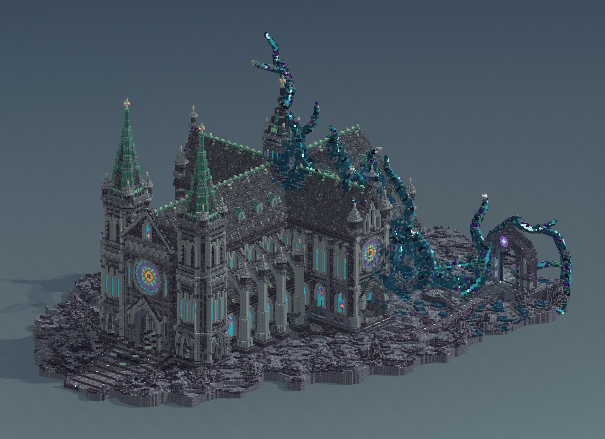
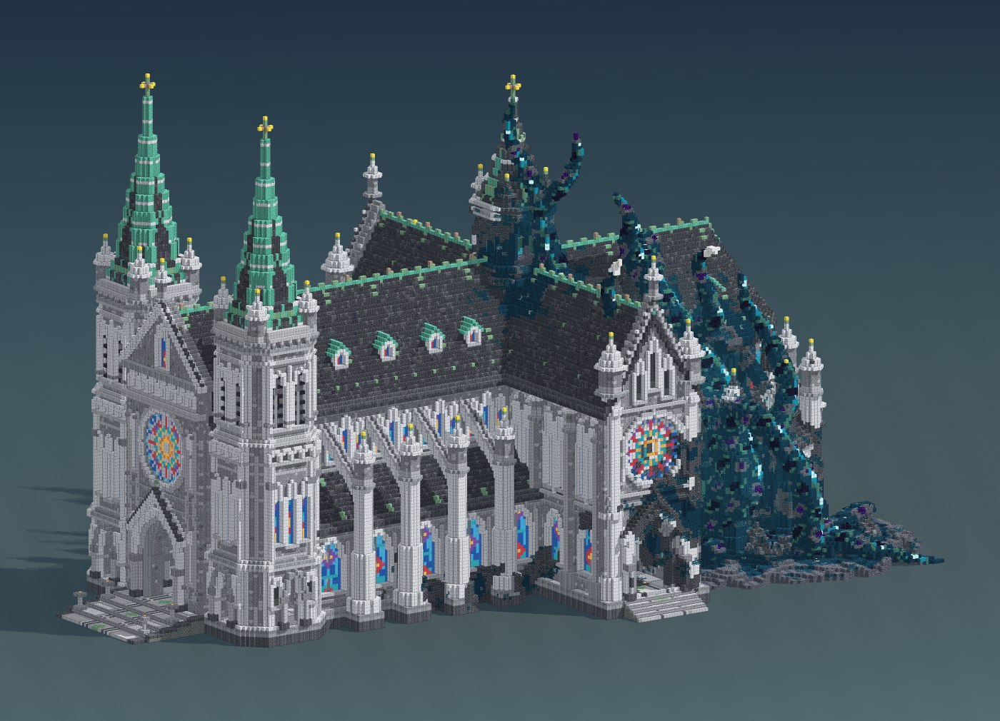

# Собор Лунных Шпилей

## Аббатство Лунных Шпилей

[Скачать `.litematic`](moonspire-cathedral-abbey.litematic) · [Общий вид](moonspire-cathedral-abbey-preview.jpg) · [Ступени у алтаря](moonspire-cathedral-abbey-interior.jpg) · [Винтовая лестница в разрезе](moonspire-cathedral-abbey-stairs.jpg) · [Клуатр и часовня](moonspire-cathedral-abbey-court.jpg)


Расширенные «Врата разлома» для **Minecraft Java 26.3**. В двух башнях широкие винтовые лестницы поднимаются **по полблока** до верхних галерей. Восточная лестница соединяется с органным балконом. У алтаря — шесть скруглённых полуступеней вокруг уцелевшей стороны разлома; в нефе — круглые основания колонн, кольцевые люстры и каменная розетка в полу.

Из западного крыла можно пройти в **клуатр** — крытые аркады вокруг открытого двора со светящимся колодцем. От него дорожка поднимается к **Часовне Тишины**: под куполом — витражи, скамьи и аметистовый алтарь. Крипта, мост, смотровая площадка и незажжённая обсидиановая рама **13 × 18** сохранены.

**Размер: 341 × 174 × 346 блоков** (ширина × высота × длина), **1 246 477 блоков** без воздуха. В модели повторно проверена защита от обычного наземного спавна без света неба, включая новые крыши и дворы. Действуют те же оговорки, что и для «Врат разлома»: схема не меняет правила мира и не мешает мобам прийти извне. Разрез лестницы — только превью: в самой схеме стены башни на месте.

## Врата разлома — тёмный собор с ландшафтом

[Скачать `.litematic`](moonspire-cathedral-rift.litematic) · [Общий вид](moonspire-cathedral-rift-preview.jpg) · [Портал после активации (рендер)](moonspire-cathedral-rift-portal.jpg)



Это расширенная версия «Эха глубин» для Minecraft Java 26.3: чернит, глубинный сланец, базальтовые гряды и скалковые ветви от шпиля до портальной арки. От восточного выхода дорожка ведёт через овраг к вратам; у неё есть ответвление на восьмиугольную смотровую площадку. Из нефа по-прежнему можно пройти в крипту.

- **Габариты:** **259 × 174 × 346 блоков** (ширина × высота × длина), **1 109 076** блоков без учёта воздуха.
- **Защита от обычного спавна в Верхнем мире:** в мостовую и кладку встроены источники света, на крыше и карнизах — нижние плиты, а в крипте — ковры в том числе на освещённых участках. Ступени на подъёмах — нижние, перевёрнутые ступени в отделке проверены отдельно. Проверка модели не учитывает свет неба: на потенциальных местах спавна не осталось уровня ниже 3. См. [механику защиты](https://minecraft.wiki/w/Tutorial:Spawn-proofing).
- **Портал в Незер:** внутри стрельчатой арки есть обычная прямоугольная рамка из обсидиана с проёмом **13 × 18**. В схеме она **не зажжена**; для запуска используй огниво на верхней грани нижнего ряда обсидиана **внутри** проёма. Плачущий обсидиан вокруг — только декор.

Схема не меняет правила мира. Свет и покрытие рассчитаны на естественный спавн обычных наземных монстров, а не на события вроде рейдов, фантомов или спавнеров. Для размещения лучше выбрать участок вне болота и над `Y=40`. Мобы могут зайти снаружи, а активный портал [может создавать зомбифицированных пиглинов](https://minecraft.wiki/w/Random_Tick).

## Классические варианты

| Тёмный — чернит и багровые витражи | Светлый — кварц и бирюзовая кровля |
| --- | --- |
| [](moonspire-cathedral-dark-preview.jpg) | [](moonspire-cathedral-light-preview.jpg) |
| [Скачать тёмную схему `.litematic`](moonspire-cathedral-dark.litematic) | [Скачать светлую схему `.litematic`](moonspire-cathedral-light.litematic) |

Меняются материалы, витражи и отделка интерьера; планировка и габариты одинаковые. [Исходная схема](moonspire-cathedral.litematic) · [Превью исходной схемы](moonspire-cathedral-preview.jpg).

Готический собор с двумя башнями над главным входом и третьим шпилем над средокрестием. У него три витража-розы, аркбутаны и полукруглая в плане апсида. Внутри — сводчатый неф со скамьями и люстрами, органная галерея и алтарь. В башнях есть винтовые лестницы.

- **Игра:** Minecraft **Java Edition 26.3**, схема для **Litematica**.
- **Габариты (ширина × высота × длина):** **169 × 159 × 255 блоков**, включая фундамент и входные лестницы.
- **Объём постройки:** **475 519 блоков** без учёта воздуха. Все материалы ванильные, дополнительных модов на блоки не нужно.

## Эхо глубин — скалковая версия

[Скачать `.litematic`](moonspire-cathedral-sculk.litematic) · [Общий вид](moonspire-cathedral-sculk-preview.jpg) · [Скалковое ядро у алтаря](moonspire-cathedral-sculk-heart.jpg)



Заражение начинается в крипте под хором, пробивает пол у алтаря и выходит на восточную стену. Оттуда тёмные наросты с голубыми прожилками тянутся по аркбутанам и крыше до центрального шпиля. Главный фасад почти не тронут. Из западного прохода можно спуститься в крипту по лестнице; у разлома сохранились обход и часть алтаря.

**Габариты:** **169 × 173 × 266 блоков** (ширина × высота × длина), включая крипту и обломки. **Всего 543 784 блока** без учёта воздуха, все ванильные. Скалковые крикуны в схеме не могут призвать Хранителя (`can_summon=false`).

## Как открыть

1. В профиле Java 26.3 установи [Litematica для 26.3](https://modrinth.com/mod/litematica/version/0.29.1) и подходящую [MaLiLib](https://modrinth.com/mod/malilib/versions?g=26.3). Сборка Litematica по ссылке предназначена для Fabric.
2. Скопируй нужный файл `.litematic` в папку `schematics` своего профиля Minecraft. Если папки нет, создай её в каталоге игры этого профиля.
3. В мире нажми **M → Load Schematics**, выбери файл и нажми **Load**, оставив включённым **Create Placement**.
4. В **Schematic Placements** настрой координаты и поворот. Без поворота главный фасад смотрит на север (`−Z`), а точка привязки — нижний северо-западный угол области. Для исходной, светлой и тёмной схем при начале на `Y=64` верхний шпиль будет на `Y=222`.

Голограмму можно использовать для ручной постройки. Для вставки блоков попробуй сначала отдельный плоский мир в творческом режиме: выбери режим **Paste Schematic in World** и назначь клавишу **executeOperation** в настройках Litematica. При вставке в существующий мир сделай резервную копию: режим замены влияет на то, какие блоки мира будут перезаписаны.

**Для «Эха глубин»:** точка привязки на 14 блоков ниже нижней ступени главного входа. Если верхний слой земли на `Y=63`, поставь начало схемы на `Y=50`. Чтобы существующая земля не заполнила крипту, расчисти её заранее или используй режим замены **All** (с воздухом) в тестовом мире. Этот режим перезаписывает блоки во всей области схемы.

**Для «Врат разлома»:** выдели участок не меньше **259 × 346** блоков. При верхнем слое земли на `Y=63` начни схему на `Y=58`: основание рельефа окажется на `Y=64`, начало входной дорожки — на `Y=67`, самая высокая точка — на `Y=231`. К дорожке можно добавить короткую лестницу, а края базальтовых гряд состыковать с рельефом мира. Перед вставкой в существующий мир расчисти места, где голограмма требует воздуха, особенно в крипте и под мостом, если земля выше. **All** удобно проверять в копии мира: оно стирает блоки мира даже в пустых ячейках всей прямоугольной области, а не только там, где есть постройка.

**Для Аббатства:** оставь участок **341 × 346** блоков. Высоту можно взять ту же: начало на `Y=58` для земли на `Y=63`. Если сравниваешь две версии без поворота, точка начала Аббатства лежит на **82 блока западнее** точки «Врат разлома» при той же позиции собора. Для фактической замены лучше пользоваться копией мира: старые ступени и стены должны быть убраны там, где в новой схеме воздух.

## Пересборка и проверки

Готовые схемы не требуют Python. Для пересборки используй Python 3.10 или новее:

```sh
python -m pip install -r requirements.txt
python tools/build_cathedral.py --variant dark --preview moonspire-cathedral-dark-preview.jpg
python tools/build_cathedral.py --variant light --preview moonspire-cathedral-light-preview.jpg
python tools/build_cathedral.py --preview moonspire-cathedral-preview.jpg
python -m tools.build_sculk_cathedral --preview moonspire-cathedral-sculk-preview.jpg
python -m tools.build_rift_cathedral --preview moonspire-cathedral-rift-preview.jpg
python -m tools.build_abbey_cathedral --preview moonspire-cathedral-abbey-preview.jpg
python -m unittest discover -s tests -v
```

Проверки распаковывают NBT и сверяют блоки схем с моделью. Для цветовых вариантов проверяются позиции и свойства блоков; для скалковых — проходы в крипту и крепление жил к стенам. Для «Врат разлома» и Аббатства проверяются также геометрия обсидиановой рамы и ночная защита от обычного спавна. У Аббатства проверяются высота полуступеней, маршруты до галерей и проходимость новых зданий. Все палитры сверены с реестром блоков Java 26.3. Превью отрисованы из модели; движение, вставка и активация портала в клиенте Minecraft не тестировались.
