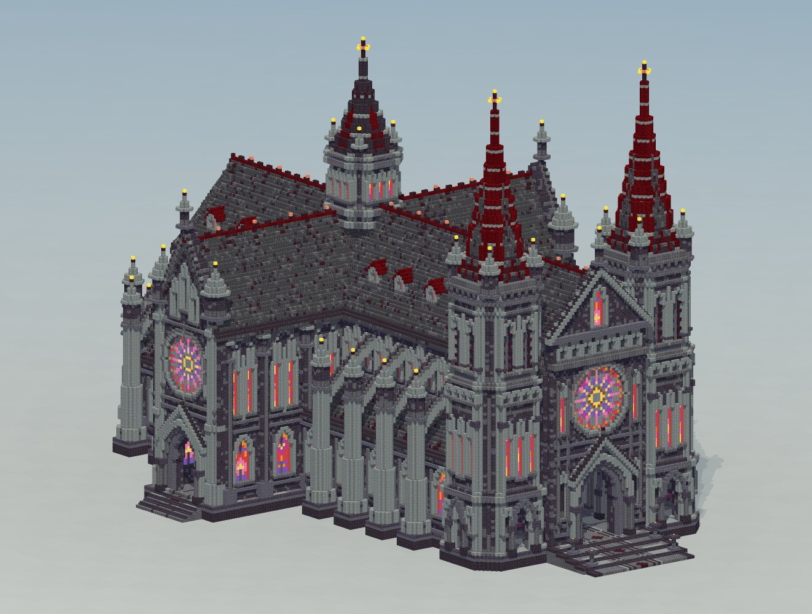
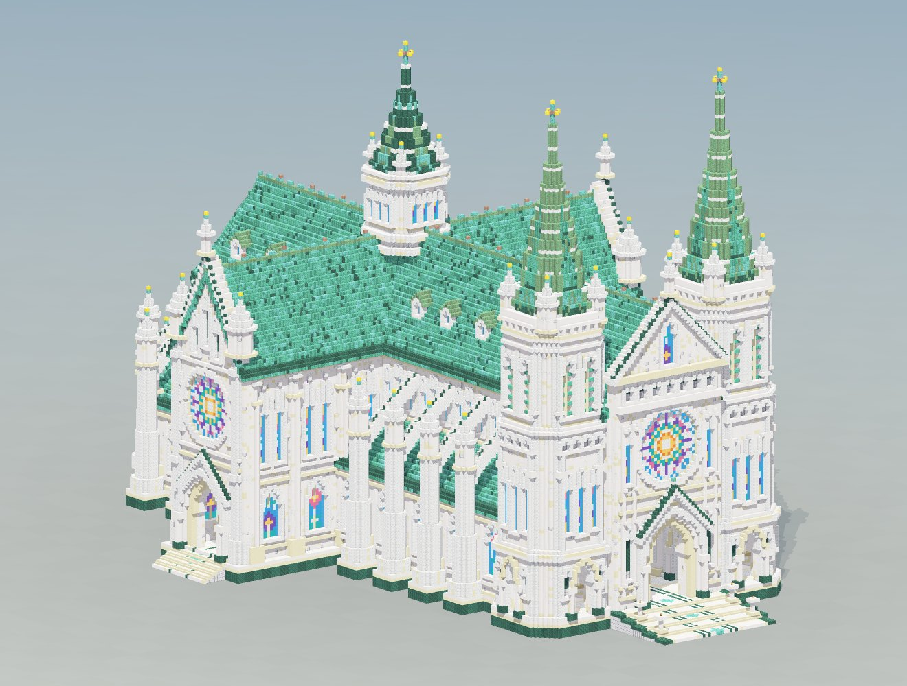

# Собор Лунных Шпилей

| Тёмный — чернит и багровые витражи | Светлый — кварц и бирюзовая кровля |
| --- | --- |
| [](moonspire-cathedral-dark-preview.jpg) | [](moonspire-cathedral-light-preview.jpg) |
| [Скачать тёмную схему `.litematic`](moonspire-cathedral-dark.litematic) | [Скачать светлую схему `.litematic`](moonspire-cathedral-light.litematic) |

Меняются материалы, витражи и отделка интерьера; планировка и габариты одинаковые. [Исходная схема](moonspire-cathedral.litematic) · [Превью исходной схемы](moonspire-cathedral-preview.jpg).

Готический собор с двумя башнями над главным входом и третьим шпилем над средокрестием. У него три витража-розы, аркбутаны и полукруглая в плане апсида. Внутри — сводчатый неф со скамьями и люстрами, органная галерея и алтарь. В башнях есть винтовые лестницы.

- **Игра:** Minecraft **Java Edition 26.3**, схема для **Litematica**.
- **Габариты (ширина × высота × длина):** **169 × 159 × 255 блоков**, включая фундамент и входные лестницы.
- **Объём постройки:** **475 519 блоков** без учёта воздуха. Все материалы ванильные, дополнительных модов на блоки не нужно.

## Как открыть

1. В профиле Java 26.3 установи [Litematica для 26.3](https://modrinth.com/mod/litematica/version/0.29.1) и подходящую [MaLiLib](https://modrinth.com/mod/malilib/versions?g=26.3). Сборка Litematica по ссылке предназначена для Fabric.
2. Скопируй нужный файл `.litematic` в папку `schematics` своего профиля Minecraft. Если папки нет, создай её в каталоге игры этого профиля.
3. В мире нажми **M → Load Schematics**, выбери файл и нажми **Load**, оставив включённым **Create Placement**.
4. В **Schematic Placements** настрой координаты и поворот. Без поворота главный фасад смотрит на север (`−Z`), а точка привязки — нижний северо-западный угол области. На плоской площадке с основанием на `Y=64` верхний шпиль будет на `Y=222`.

Голограмму можно использовать для ручной постройки. Для вставки блоков попробуй сначала отдельный плоский мир в творческом режиме: выбери режим **Paste Schematic in World** и назначь клавишу **executeOperation** в настройках Litematica. При вставке в существующий мир сделай резервную копию: режим замены влияет на то, какие блоки мира будут перезаписаны.

## Пересборка и проверки

Готовые схемы не требуют Python. Для пересборки используй Python 3.10 или новее:

```sh
python -m pip install -r requirements.txt
python tools/build_cathedral.py --variant dark --preview moonspire-cathedral-dark-preview.jpg
python tools/build_cathedral.py --variant light --preview moonspire-cathedral-light-preview.jpg
python tools/build_cathedral.py --preview moonspire-cathedral-preview.jpg
python -m unittest discover -s tests -v
```

Проверки распаковывают NBT и сверяют блоки схем с моделью. В цветовых вариантах сохраняются позиции блоков и свойства вроде направления лестниц. Все палитры сверены с реестром блоков Java 26.3. Превью отрисованы из блоков схем — это не скриншоты из клиента Minecraft.
