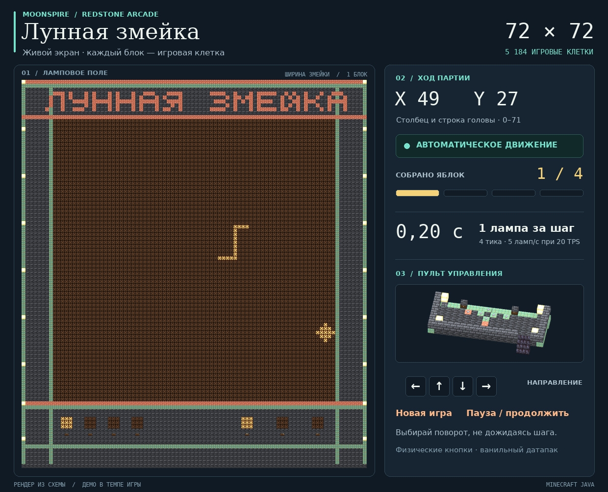

# Лунная змейка — живой экран 72 × 72

[Скачать датапак с экраном и пультом](../moonspire-snake-live-datapack.zip) · [Схема Litematica](../moonspire-snake-live.litematic) · [Демо в темпе игры (GIF)](../moonspire-snake-live.gif)

Это отдельная версия [редстоун-змейки](snake.md). Здесь **все 5 184 лампы — игровые клетки**, а не дорожки между центрами поля 6 × 6. Змейка ползёт сама, по **одной лампе каждые 4 игровых тика** (0,20 с, или 5 ламп/с при 20 TPS). Можно повернуть на любой клетке, в том числе у края или в углу, если следующий шаг остаётся внутри поля и не ведёт в тело. Экран собран из настоящих краснокаменных ламп, пульт — из шести каменных кнопок.



## Установка без модов

Нужен **Minecraft Java 26.3** или **1.21.11**. В ZIP уже есть шаблон постройки — Litematica, ресурс-пак и командные блоки не нужны.

1. Создай отдельный мир или сделай резервную копию. Скопируй `moonspire-snake-live-datapack.zip` **не распаковывая** в папку `datapacks` этого мира. Открой мир, а если он уже запущен — выполни `/reload`. Если пак виден в списке, но выключен, включи его через `/datapack enable "file/moonspire-snake-live-datapack.zip"`.
2. С правами оператора выбери **пустое место в Верхнем мире**. Размер постройки — **88 × 99 × 131** блок (X × Y × Z); экран обращён на юг. Для примера с началом в `(0, 64, 0)` выполни:

   ```mcfunction
   /forceload add 0 0 87 130
   /place template moonspire_snake:board 0 64 0
   /execute positioned 0 64 0 run function moonspire_snake:install
   ```

   При другом начале смести координаты во всех трёх командах. Первая нужна, чтобы чанки экрана и пульта оставались загруженными; не запускай её с этими координатами, если строишь в другом месте. Не ставь экран на старую змейку и не заполняй полость за лампами: там появятся блоки питания. В одном мире подключается один экран.
3. Поднимись по двойной лестнице на площадку. С медной плитки в центре видно всё поле. Для примера выше на неё можно сразу попасть командой `/tp @s 43.5 113 80.5 180 -2`. Нажми **«Новая игра»** — это отдельная кнопка слева от крестовины. Больше команды для игры не нужны.

**Через Litematica:** если нужно разместить постройку голограммой в Java 26.3, вставь `moonspire-snake-live.litematic` целиком **без поворота и зеркала** и используй её начало в команде `install`. В этом случае `/place template` не нужен; датапак всё равно должен быть включён.

## Управление

- **Новая игра:** возвращает змейку длиной 12 ламп и первое яблоко. Змейка смотрит вправо и начинает движение через 1,5 секунды при 20 TPS.
- **Стрелки:** крестовина из четырёх кнопок меняет направление на ближайшем шаге. Верхняя кнопка — ближняя к экрану. Можно нажать заранее: игра запомнит последний допустимый поворот. Разворот прямо в шею игнорируется.
- **Пауза:** отдельная кнопка справа. Повторное нажатие продолжает игру с того же места. Если нужно больше времени для прицеливания, оператор может выбрать `/function moonspire_snake:speed/slow` (8 тиков на шаг) и вернуть обычный темп через `/function moonspire_snake:speed/normal`.
- **Яблоки:** светящийся ромб можно взять любой его лампой. Следующий плод появляется в свободном месте; на четырёх шагах после подбора хвост не укорачивается. Четыре квадрата слева под полем показывают счёт. Четвёртое яблоко завершает партию победой.
- **Столкновение:** выход за поле или удар о тело останавливает игру. В клетку хвоста можно войти, если он уйдёт с неё этим же шагом. Три ламповых квадрата справа показывают движение, столкновение и победу соответственно.

Чтобы перенести постройку или выключить датапак, сначала выполни `/function moonspire_snake:uninstall` при загруженном экране. Это выключит лампы и отвяжет пульт, но не снесёт постройку. Если ты принудительно загрузил чанки, можешь снять эту загрузку командой `/forceload remove 0 0 87 130` (с поправкой на фактическое место).

## Как проверено

Датапак считывает физические кнопки каждый игровой тик и сразу отпускает их, чтобы ту же кнопку можно было нажать на следующем повороте. Во время обычного хода обновляются только новый пиксель головы и ушедший пиксель хвоста. У каждой лампы собственный блок питания за экраном; уходящая лампа гаснет в тот же тик без светящегося шлейфа.

Готовый ZIP с его встроенным шаблоном прошёл проверку на **ванильном сервере Java 26.3** и на **1.21.11**. Стенд подал импульсы на блоки кнопок, измерил точный интервал между ходами и провёл голову через все **5 184 лампы**, в том числе через все четыре угла. Также проверены погасание хвоста, пауза, рост, победа, столкновения и повторный старт. Клики в клиенте и вставка через интерфейс Litematica не испытывались. GIF — рендер блочной схемы, а не запись клиента: на участке движения он показывает каждый шаг без ускорения.

## Пересборка и тесты

```sh
python -m pip install -r requirements.txt
python -m tools.build_snake_live --preview moonspire-snake-live-preview.jpg
python -m unittest discover -s tests -p 'test_snake_live.py' -v
```

Для пересборки GIF и JPG нужны `assets/minecraft` из Java 26.3, шрифты DejaVu и компилятор C:

```sh
python -m tools.render_snake_live /путь/к/assets/minecraft
```

Для повторения нативной проверки нужен оригинальный `server.jar` одной из двух версий и подходящая Java. Прочитай [Minecraft EULA](https://aka.ms/MinecraftEULA) и, если согласен, запусти:

```sh
python -m tools.verify_snake_live --server /путь/к/server.jar --java /путь/к/java --accept-minecraft-eula
```
