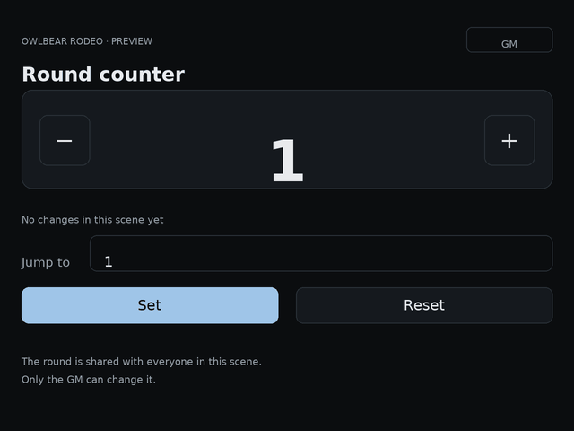

# Round Counter — расширение для Owlbear Rodeo

Небольшое расширение, которое хранит **номер раунда** для текущей сцены и
показывает его всем игрокам. Счётчик живёт в метаданных сцены через SDK
Owlbear, поэтому не требует сервера, базы данных или ключей.



## Возможности

- одна цифра раунда на сцену, синхронизированная со всеми игроками;
- кнопки `−` / `+`, поле «Jump to», сброс на раунд `1`;
- диапазон `1…9999`, неверные значения отбрасываются;
- изменение счётчика доступно только GM; игроки видят значение и автора последнего изменения;
- номер раунда дублируется в бейдже кнопки расширения (`R12`);
- тема Owlbear (светлая/тёмная) подхватывается автоматически;
- плавность 180 ms `ease-out`, без градиентов, свечений и параллакса.

## Разработка

```sh
cd owlbear-round-counter
npm install
npm run dev
```

Корневая страница `http://localhost:5173/` — самостоятельный интерактивный
предпросмотр интерфейса: можно посмотреть вид кнопки и счётчика без входа в Owlbear.

В Owlbear Rodeo: Profile → Add Extension → вставьте
`http://localhost:5173/manifest-local.json`. Затем создайте комнату и включите
расширение. Кнопка появится в левом верхнем углу.

Проверка типов и сборка:

```sh
npm run check
npm run build
```

Готовая статика окажется в `dist/`.

## Установка в Owlbear Rodeo

Готовый манифест привязан к релизу `owlbear-round-counter-v1.0.2`:

```
https://cdn.jsdelivr.net/gh/owlclockl/anifa@owlbear-round-counter-v1.0.2/owlbear-round-counter/dist/manifest-install.json
```

В Owlbear Rodeo: Profile → Add Extension → вставьте эту ссылку. Затем включите
extension в комнате — кнопка `Round Counter` появится слева вверху.

Popover в релизе собран одним файлом (`dist/extension.html` со встроенными JS
и CSS), поэтому CDN-ссылки работают без дополнительного хостинга. Полный архив
со статикой лежит в [релизе](https://github.com/owlclockl/anifa/releases/tag/owlbear-round-counter-v1.0.2).

## Технические детали

- owlbear-rodeo/sdk `3.x`, TypeScript, Vite;
- ключ метаданных: `com.owlclockl.round-counter/state`;
- состояние: `{ round, updatedBy, updatedAt }`;
- SSO/авторизация не нужна — используются роль и имя игрока из SDK.

Лицензия SDK: MIT, copyright Owlbear Rodeo.
